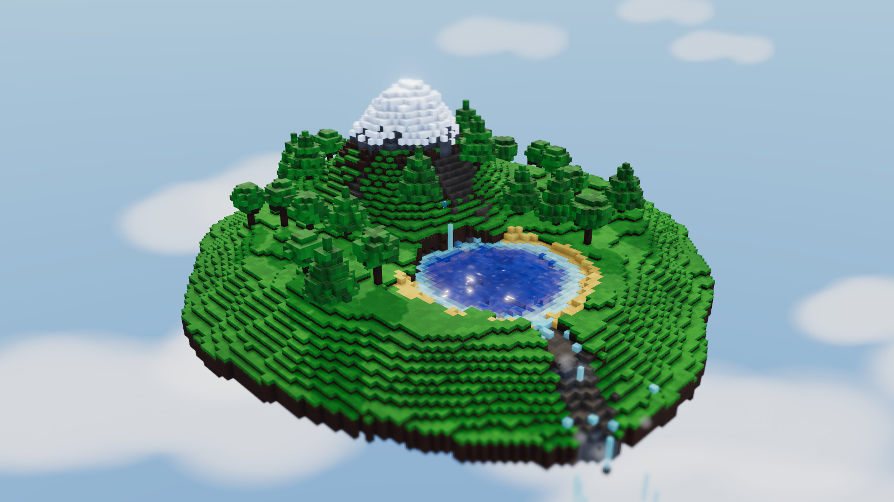

# Terrarium

**A tiny floating world to dig, flood, burn and blow up.**
A relaxing 3D voxel sandbox where every block obeys (simplified, but honest) physics:
sand slides, water levels out and pours off the edge, lava sets trees alight and hisses into
obsidian when it meets the lake, and cliffs you undercut break loose and tumble into the clouds.
No goals, no score — just a little diorama to poke at.

### ▶ Play it: **https://theeyerg.github.io/terrarium/**



| Explosions throw real debris | Lava meets the lake | A tree burning at night |
| --- | --- | --- |
|  |  |  |

---

## Controls

| Action | Mouse / key |
| --- | --- |
| Use the selected tool | **Left-click / drag** (hold to keep painting) |
| Orbit camera | **Right-drag** |
| Pan camera | **Middle-drag** |
| Zoom | **Scroll** |
| Brush size | **Shift / Ctrl / Alt + scroll**, or **[** and **]** |
| Materials | **1 – 9** (or click a swatch in the palette) |
| Tools | **B** add · **E** erase · **D** dig · **H** heat · **C** cool · **X** explode · **P** rain / pour · **I** inspect |
| Pause / play · step one tick | **Space** · **N** |
| Simulation speed | **-** / **=** (0.25× – 4×) |
| Undo (20 steps) | **Ctrl + Z** |
| New island · new island from a seed | **R** · the ⟳ button |
| Save / load (browser storage) | **Ctrl + S** / **Ctrl + L** |
| Screenshot (PNG) | **K** |
| Cinematic auto-rotate camera | **V** (Esc to leave) |
| Tilt-shift miniature effect | **T** |
| Stats / FPS | **F** |
| Mute | **M** |
| Hide the UI | **Tab** |
| Help | **?** |
| Touch | one finger = tool, two fingers = orbit + pinch zoom |

## Features

**Simulation** (a 3D cellular automaton in a Web Worker)
- 128 × 64 × 128 voxel grid in typed arrays (material, temperature, lifetime, flags).
- 23 materials, each with density, state (solid / powder / liquid / gas), heat conductivity,
  melting & freezing points, flammability, ignition temperature, burn time, explosion
  hardness and acid resistance.
- **Powders** (sand, gravel, snow, gunpowder, mud, embers) fall and pile up at a material-specific
  angle of repose — sand settles at ~34° (measured in the tests), gravel steeper, snow steeper still.
- **Liquids** flow in all 8 horizontal directions, fill basins, level out, pour off edges, and sort
  by density (oil floats on water, sand sinks through it, lava sinks and hardens).
- **Gases** (steam, smoke, fire) rise, drift and fade; steam cools and rains back down.
- **Heat** conducts between neighbours (using the weaker conductor), relaxes toward an
  altitude-dependent ambient temperature (so the peak keeps its snow), and drives phase changes:
  water ⇄ ice ⇄ steam, snow → water, sand → glass, stone → lava → obsidian, mud → dirt.
  Hot rock and metal glow red → orange → white.
- **Fire** needs fuel: it spreads by flammability, licks upward, gives off smoke and embers and
  burns out (grass burns back to dirt). Water puts it out with a hiss.
- **Reactions**: lava + water → obsidian + steam; acid dissolves most things (glass is immune,
  obsidian and metal resist); wet dirt turns to mud and dries out again; grass slowly spreads onto
  lit dirt that's near water; gunpowder explodes and chain-reacts.
- **Structural support**: after anything solid is removed (erase, dig, blasts, acid, burning
  trunks, melting) the touching solids are flood-filled; pieces not connected to the island
  break loose and fall as flying debris, then land as voxels again. Freshly quenched obsidian
  sinks if it isn't resting on anything; ice and wood float.
- **Explosions** carve a crater, fling voxels outward with real velocities, scorch the rim,
  start fires and shake the camera.
- Random update order (shuffled chunks, random scan direction, random neighbour choice) so nothing
  drifts one way; each cell moves at most once per tick.
- A spring at the head of the waterfall channel keeps the lake and falls running forever;
  water that falls off the island drops into the clouds.

**Rendering**
- Greedy-meshed 16³ chunks (only changed chunks are rebuilt), opaque and translucent passes.
- Per-vertex ambient occlusion and per-voxel colour variation (done in the shader from the world
  position, so greedy merging still works), plus a fine 4×4 "texel" grain on each face.
- Sun with soft PCF shadows, hemisphere light, a bounce light from the cloud sea, and a pool of
  point lights that follow lava pools and fires so they tint nearby blocks.
- Bloom on lava, fire, embers and glowing rock; NaN-safe post chain.
- Translucent water with a lowered surface, rippling normals, depth tint (turquoise shallows,
  deep blue middle), sparkles and falling-water streaks + spray; framed glass and ice blocks.
- Gradient sky with a slow day/night cycle, sun and moon discs, twinkling stars, fog and a drifting
  cloud sea below the island.
- Particles for explosions, splashes, steam hiss, sparks, embers, smoke, dust and mist.
- Optional tilt-shift for the tiny-diorama look (fades out when you zoom in close).
- Procedural island from a seed: grass / dirt / stone layers, a snowy peak, a sandy lake fed by a
  mountain trickle, a waterfall channel off the edge, oak and pine trees, a cave tunnel to a
  chamber with a lava pocket (ringed with obsidian), gravel patches and metal veins.

**UI**
- Floating glass toolbar with icons + tooltips, material palette with swatches, top bar, settings
  (seed, day/night, time of day, day length, tilt-shift, bloom, shadows), help sheet, inspect
  read-out (material, temperature, state, density), toasts, paused indicator.
- Undo (last 20 snapshots, RLE-compressed), clear to a flat slab, regenerate with a seed,
  save / load to `localStorage`, PNG screenshot, cinematic camera, FPS / sim stats.
- Soft procedural WebAudio sound (no audio files) that only starts after your first click,
  with a remembered mute toggle.
- Title / loading screen, touch support and a compact phone layout.

## Performance

Measured with the Playwright suite (headless Chrome, RTX 3070, 1440×900):

| | |
| --- | --- |
| Frame rate | capped by the display (180 fps headless); main thread ~1.2 ms CPU per frame |
| Simulation | steady 30 ticks/s; ~4 ms per tick in the steady state (Node bench 3.7 ms), 7-10 ms while lots is happening |
| Remeshing | ~0.8 ms per chunk, budgeted per worker loop so it never blocks |

How it stays smooth: the simulation and meshing run in a Web Worker, so the main thread only
uploads geometry. Only **awake** chunks are simulated (a chunk sleeps once nothing in it moves or
is warmer/colder than ambient). Only dirty chunks are re-meshed, a few per frame are uploaded,
and render resolution adapts automatically (drops when fps falls below 50, climbs back when
there's headroom) for weaker laptops.

## Development

```bash
npm install
npm run dev          # http://localhost:5173
npm run build        # type-check + production build into dist/
npm run test:sim     # headless simulation tests (plain Node)
```

Browser tests (need `npm run dev -- --port 5179` running and Google Chrome installed):

```bash
node tests/e2e.mjs            # mouse dig + undo, pit flooding, lava into the lake, burning tree, cliff blast, perf
node tests/e2e-features.mjs   # save/load, screenshot, cinematic, seeds, clear, materials, oil fire, acid, gunpowder, cave, touch
node tests/ui-shots.mjs       # screenshots of title, help, inspect, night, sunset
```

Deployment: every push to `main` runs the simulation tests, builds, and publishes to GitHub Pages
via `.github/workflows/deploy.yml`.

### Code map

```
src/sim/       worker side: world arrays, generator, cellular automaton, mesher, debris,
               structural support, tools, snapshots (undo/save), worker loop
src/render/    chunk materials (shader patches), chunk manager, sky + lighting, post-processing,
               particles / gas sprites / debris / glow lights, brush preview
src/ui/        DOM UI, icons, styles
src/audio/     WebAudio synth
src/camera.ts  orbit camera with smooth zoom, anti-clip, shake, cinematic mode
src/input.ts   voxel DDA raycast and brush strokes
tests/         Node sim tests + Playwright browser scenarios
```

See [PLAN.md](PLAN.md) for the original architecture plan and checklist.

## Design decisions (made without asking)

- **One voxel = one world unit**, world grid fixed at 128×64×128, chunks of 16³.
- **Simulation rate** is 30 ticks/s at 1× (0.25×–4× selectable); rendering runs at display rate
  and debris is extrapolated between ticks.
- **Liquid / powder falling speed** is 2 cells per tick; to keep falling water looking like a stream
  (not dotted cubes) the mesher draws falling liquid as thin stretched streaks.
- **A lone water droplet** can't spread thinner than one voxel, so in a cellular automaton it would
  wander forever. Isolated droplets therefore evaporate after a few seconds (quickly when sitting
  on a lake). This is what keeps lake surfaces flat.
- **The lake is fed by a spring** at the waterfall's head (plus a gentle trickle on the mountain),
  so the falls never run dry. You can place your own springs too (it's in the palette).
- **"Anchored" ground** for the support check means "connected to a big structure" (more than
  14,000 voxels) since a floating island has no bedrock. Smaller disconnected pieces fall.
- **Ambient temperature drops with height** (lapse rate), so the snow cap is stable and water poured
  high on the mountain can freeze over time — but freshly placed water never spawns frozen.
- **Gunpowder** sets off any other gunpowder within ~2× its blast radius, so trails chain reliably.
- **Fire on grass** is deliberately weak, so a burning tree doesn't torch the whole island.
- **Extra materials** beyond the brief: Spring (endless water source) and Ember (falling sparks
  that light fuel). 23 materials total.
- **Clear** gives you a flat grassy slab rather than empty sky, so there's something to build on.
- **R regenerates immediately** with a random seed; it's undoable with Ctrl+Z.
- **Sound** is synthesized (no files), muted until the first click, and remembers your choice.
- **Tilt-shift** is on by default but subtle, and fades out for close-ups.
- **TypeScript 7 / Vite 8 / Three.js r187**, no UI framework, no other runtime dependencies.

## Designer's self-review: 10 things that felt unpolished (and were fixed)

1. **Lake surface was lumpy** — spring water arrived as droplets that never settled. Moved the main
   spring to the waterfall channel, made isolated droplets evaporate, and lowered/depth-tinted the
   liquid surface so it reads as water, not stacked glass cubes.
2. **The waterfall was a few falling cubes** — now drawn as stretched streaks with drifting mist.
3. **A NaN pixel could black out the whole screen** (bloom smeared it everywhere during fires and
   explosions) — lights nudged off the voxel grid and a bit-exact NaN scrub pass added.
4. **Grass tops had brown checkerboard noise** — colour variation now stays within greens.
5. **Shaded cliffs and the island's underside were nearly black** — added a cloud-bounce fill light.
6. **Lava poured into the lake built a floating black tower** — quenched obsidian now sinks if
   unsupported, and lava plunges in a little before it freezes.
7. **Water poured high on the mountain froze in mid-air and hung there** — liquids spawn at a sane
   temperature, ice is structural (falls when unsupported) and floats.
8. **Fire was a blinding wall of white blobs and the grass spread it everywhere** — calmer flame
   sprites, fewer/smaller embers, softer glow lights, weaker grass fires.
9. **Holding Add with a solid block stacked a tower at the camera; placing felt weightless** —
   solids only paint while the cursor moves, and placement pops with dust and a click.
10. **Small UX papercuts** — toasts collided with the top bar, the seed box stayed open after
    Generate, the phone layout wrapped into three rows, pause was easy to miss, the cursor was a
    plain arrow, tilt-shift blurred close-ups, and the first seconds showed the water still
    settling. All fixed (toasts above the toolbar, compact phone bar, "Paused" pill, crosshair /
    grab cursor, distance-aware tilt-shift, a short off-screen warm-up while loading).

## License

MIT — see [LICENSE](LICENSE).
