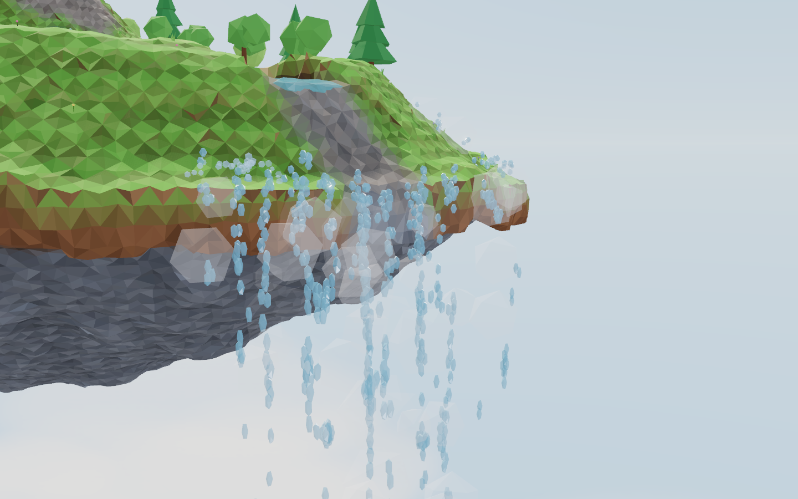
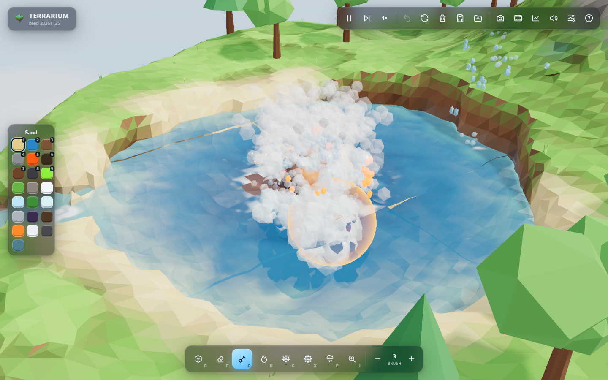
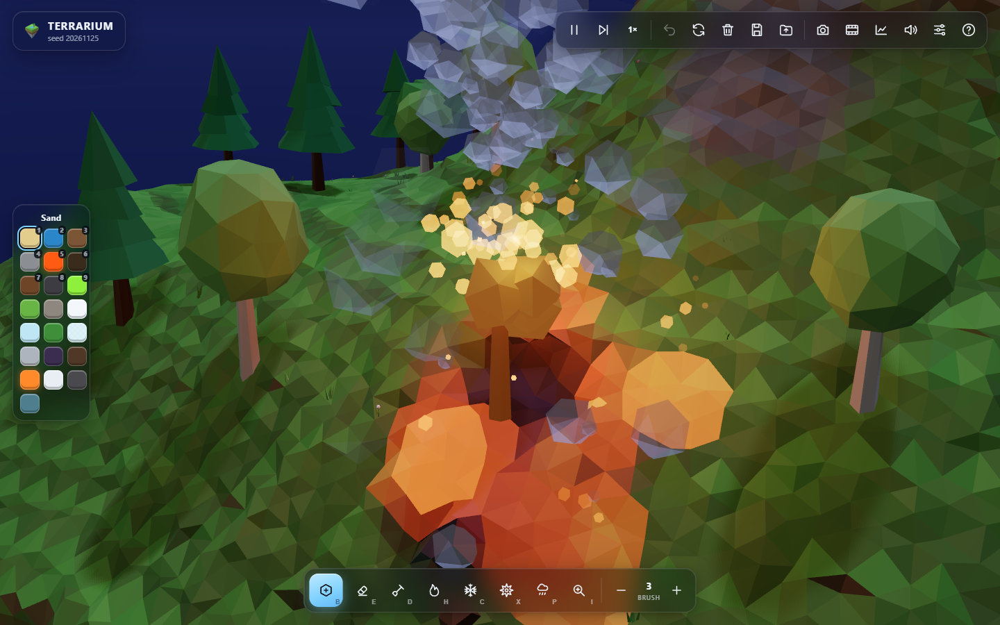
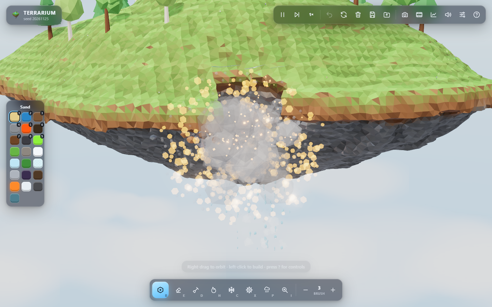
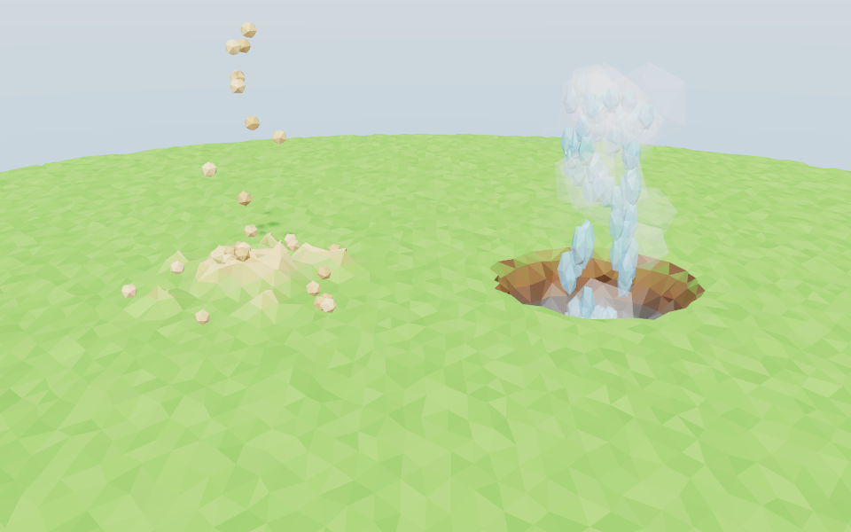

# Terrarium

**A tiny low poly floating world to dig, flood, burn and blow up.**
A relaxing 3D physics sandbox in the style of a hand-made low poly diorama. Sand pours and
slumps into soft mounds, water spreads out and pours off the edge as a waterfall, lava hisses
into the lake and builds an obsidian island, trees catch fire and burn down to stumps, and
blasts send chunks of rock tumbling into the clouds. No goals, no score.

### ▶ Play it: **https://theeyerg.github.io/terrarium/**


| Waterfall off the edge | Lava meets the lake | A tree burning at night |
| --- | --- | --- |
|  |  |  |
| **Blast under a cliff** | **Pouring sand and water** | |
|  |  | |

---

## Controls

| Action | Mouse / key |
| --- | --- |
| Use the selected tool | **Left-click / drag** (hold to keep painting) |
| Orbit camera | **Right-drag** |
| Pan camera | **Middle-drag** |
| Zoom | **Scroll** |
| Brush size | **Shift / Ctrl / Alt + scroll**, or **[** and **]** |
| Materials | **1 – 9** (or click a swatch in the palette) |
| Tools | **B** add · **E** erase · **D** dig · **H** heat · **C** cool · **X** explode · **P** rain / pour · **I** inspect |
| Pause / play · step one tick | **Space** · **N** |
| Simulation speed | **-** / **=** (0.25× – 4×) |
| Undo (20 steps) | **Ctrl + Z** |
| New island · from a seed | **R** · the ⟳ button |
| Save / load (browser storage) | **Ctrl + S** / **Ctrl + L** |
| Screenshot (PNG) · cinematic camera | **K** · **V** |
| Tilt-shift · stats · mute · hide UI · help | **T** · **F** · **M** · **Tab** · **?** |
| Touch | one finger = tool, two fingers = orbit + pinch zoom |

## How it works

The world is still a 128 × 64 × 128 voxel grid, but nothing is drawn as cubes and nothing
moves one cell at a time any more.

**Low poly terrain**
- Every cell stores how *full* it is (0–1) as well as its material. The terrain mesh is built
  with **Surface Nets** on that fill field, so slopes, craters and caves come out as soft
  shapes, then drawn **flat shaded** (non-indexed triangles, one normal and colour per face).
- Vertices get a small jitter seeded by their position so surfaces look hand-made.
- Face colours blend the palette colours of neighbouring materials (grass fades into dirt,
  sand into stone), steep grass turns into earthy cliffs, steep snow shows rock, and a soft
  ambient-occlusion term darkens hollows. Each material has a small cohesive 3-shade palette.
- Trees (pines, oaks, round trees), rocks, grass tufts, flowers and bushes are separate low
  poly models placed on the terrain. Trees sway, burn, char and fall over; decorations shrink
  away when the ground under them changes.
- Brushes have a soft falloff: dig, add and erase grow or carve a little fill each tick, so
  edits come out rounded and blend in.
- Only chunks that changed are remeshed (terrain and liquid surfaces separately), in the Web
  Worker, with terrain edits first.

**Continuous liquids**
- Pools and lakes: each liquid cell holds a continuous mass. Mass settles downward, then flows
  sideways through "virtual pipes" whose flux keeps momentum, so water levels out, sloshes and
  makes waves. Water, acid, oil and lava each have their own viscosity, and a minimum puddle
  depth (surface tension) stops spills from thinning into an endless film.
- Falling liquid: the moment liquid has nothing under it, it becomes **droplet particles**
  (gravity, cohesion and velocity smoothing between neighbours) that merge back into the pool
  where they land, with foam and a splash. That's what makes the waterfall a continuous stream.
- The liquid surface is one smooth mesh per chunk with gentle animated waves, depth colour
  (turquoise shallows, deep blue middle), fresnel, foam along shores and impacts, and light
  faceting. Oil floats on water (darker, slower); lava is thick and glowing with a crust that
  cools to obsidian.
- Reactions still work: lava + water → steam + obsidian (the lumps sink and pile up), acid
  dissolves things (not glass), dirt soaks into mud, dug holes fill up.

**Rigid bodies (Rapier)**
- Falling sand, gravel and snow become small low poly grains; explosions throw chunky rocks;
  unsupported terrain breaks off as **one rigid chunk** that tumbles; knocked or undermined trees
  fall over. All of them bounce, roll, rub and come to rest on per-chunk trimesh colliders built
  from the same triangles you see.
- When something settles it **shrinks away while its fill is poured back into the grid**,
  spread over the neighbouring columns, so piles grow into smooth mounds.

**Fire, smoke and steam** are free particles drawn as faceted puffs: they rise with buoyancy,
swirl, grow and fade with easing. Fire heats the cells it passes through (that's how it spreads),
water puts it out, steam cools and condenses back into rain, sparks fall and light fuel.

**No teleporting**
- The simulation runs at a fixed 30 Hz in a Web Worker. On the main thread every rigid body is
  **interpolated** (position lerp + rotation slerp, continuing from where it is currently drawn)
  and every particle is **extrapolated** along its velocity, every frame.
- Material changes never pop: the terrain shader lerps from the old colour to the new one,
  melting / freezing gives a puff, settling bodies shrink out, trees char gradually.
- `tests/smooth.mjs` measures it: it tracks every flying body for 6 s of real frames
  (~60–80k frame steps) and counts teleports. Result: **0 jumps**, 0 bodies that popped out.

**Look**: pastel sky gradient with a warm glow around the sun, soft warm light and gentle
shadows, light fog, a drifting cloud sea, bloom on lava and fire, day/night cycle with stars,
optional tilt-shift miniature effect, eased and damped camera.

## Performance

Measured with the Playwright suites (headless Chrome, RTX 3070):

| | |
| --- | --- |
| Frame rate | display-capped (≈170–180 fps headless); main thread ≈4.5 ms CPU per frame |
| Simulation, calm island | ≈6.7 ms per tick (budget at 30 Hz: 33 ms) |
| Simulation, busy (lava pour + blast + fire + sand) | ≈25 ms per tick |
| Remeshing | ≈0.8–1 ms per chunk, time-budgeted per worker loop |

What keeps it smooth: everything heavy runs in the worker; only awake chunks are simulated;
heat conduction skips cells that are already at ambient and runs each warm chunk every other
tick with a stability-limited step; liquid flow only visits chunks and faces that actually
carry liquid; droplet cohesion runs every other tick; Rapier uses 2 solver iterations and body
counts are capped (180 grains, 90 rocks, 6 chunks); render resolution adapts when the frame
rate drops below 50.

## Development

```bash
npm install
npm run dev          # http://localhost:5173
npm run build        # type-check + production build into dist/
npm run test:sim     # headless simulation tests (plain Node, uses Rapier's WASM build)
```

Browser tests need `npm run dev -- --port 5179` running and Google Chrome installed:

```bash
node tests/e2e.mjs            # mouse dig + undo, pit flooding, lava into the lake, burning tree, cliff blast, perf
node tests/e2e-features.mjs   # save/load, screenshot, cinematic, seeds, clear, materials, oil fire, gunpowder, cave, touch
node tests/smooth.mjs         # teleport / pop detector for moving bodies
node tests/look.mjs           # screenshot tour (hero, waterfall, peak, sand pour, sunset, night)
node tests/frames.mjs         # frame sequence of sand and water pours
node tests/bench.ts           # headless tick benchmark   (node tests/prof2.ts for a per-system profile)
```

Every push to `main` runs the simulation tests, builds and publishes to GitHub Pages.

### Code map

```
src/sim/       worker side
  world.ts       grid arrays (mat, fill, mass, flux, temp, colour-change history), wake/dirty tracking
  generate.ts    island generator (fractional fill), trees and decorations as specs
  simulate.ts    tick orchestration, powders, burning, heat + phase changes, explosions, deposits
  liquids.ts     virtual-pipe liquid flow, reactions, droplet particles
  gas.ts         fire / smoke / steam / spark particles
  physics.ts     Rapier world: terrain colliders, grains, rocks, chunks, trees, merge-back
  trees.ts       tree state: standing, burning, burnt, fallen
  structure.ts   support check -> tumbling chunks
  mesher.ts      surface nets for terrain and liquids, palette, AO
  tools.ts       soft brushes, pour, heat/cool, explode
  snapshot.ts    RLE snapshots for undo and save/load
src/render/    terrain + liquid materials, interpolated bodies, droplets, gas puffs, trees and
               decorations, effect particles, glow lights, sky, post-processing, brush preview
src/ui/  src/audio/  src/camera.ts  src/input.ts
```

## Design decisions (made without asking)

- **The grid stays 128 × 64 × 128** with 16³ chunks; the surface sits at half fill.
- **Liquids are a layered heightfield, not a pure 2D one.** Each layer of liquid cells levels
  out on its own and overfull cells push up, which handles caves, overhangs and stacked pools
  that a single height-per-column field can't. Droplets are SPH-flavoured (cohesion + XSPH
  velocity smoothing) rather than full PBF, which was plenty for streams and splashes.
- **Rapier** (`@dimforge/rapier3d-compat`, WASM inlined) runs inside the simulation worker so
  physics and the grid stay in sync. Grains are balls with strong rolling resistance; rocks are
  convex hulls of the same jittered icosahedra the renderer draws.
- **Settled bodies dissolve into the terrain** instead of staying as objects forever, so the
  world stays editable and cheap. Bodies that never come to rest merge after 8–20 s.
- **Trees, rocks and plants are models, not voxels.** Trees catch fire from hot air around
  them, burn for ~16 s, char and leave a stump; blasts or digging out their footing tips them
  over as physics bodies.
- **Quenched lava lumps sink** as rocks and pile up on the lake bed, so lava poured into the
  lake builds a little obsidian island.
- **A minimum puddle depth** stops liquid from creeping onto dry ground in an endless film.
- **Body caps** (180 grains, 90 rocks, 6 chunks); beyond them sand slumps down cell by cell
  instead (still blended, never popping) and very large loose pieces stay put.
- **Saves from v1 aren't compatible** (new key `terrarium-save-v2`).
- Everything else from v1 is kept: all 23 materials, all tools, the UI, sound, undo, seeds,
  save/load, screenshots, cinematic camera, touch.

## Art director's review: 10 things that looked off (and were fixed)

1. **The sky read as flat grey.** Pastel blue gradient, a warm glow around the sun, lighter and
   fewer clouds, and the lower sky tinted so the island floats in blue air.
2. **Grass was speckled with brown triangles.** Jitter alone tilted faces past the "cliff"
   threshold; only genuinely steep faces turn earthy now, and facet shading is calmer.
3. **The waterfall was a sparse rain of crystals.** Smaller, rounder, overlapping drops stretched
   along their velocity, plus spray, so the falls read as a ribbon of water.
4. **Water looked milky and pale.** Colours moved to linear space with a turquoise-to-deep-blue
   depth ramp, gentler fresnel and less environment reflection.
5. **Thin bright lines streaked across lakes.** The liquid surface ended at thin sand cells and
   its underside showed through the water; it now tucks into any terrain it touches.
6. **Explosions were a blown-out white blob.** A third of the sparks, warm orange instead of
   white-hot, a short soft flash, and chunky debris you can actually see.
7. **Lava hitting water made a wall of steam.** Fewer, smaller, more transparent steam puffs.
8. **Burnt trees stayed as tall black poles.** The trunk burns down to a short charred stump.
9. **Poured sand rolled across the island and left little spikes.** Grains get rolling
   resistance, and settling grains share their fill with neighbouring columns, so piles grow
   into smooth mounds.
10. **Edits and undo lagged a second behind the cursor.** Terrain chunks now remesh before liquid
    surfaces, and undo remeshes only the chunks that differ, immediately; the screenshot is
    copied to a 2D canvas so the PNG arrives in ~1 s instead of ~7 s.

## License

MIT — see [LICENSE](LICENSE).
